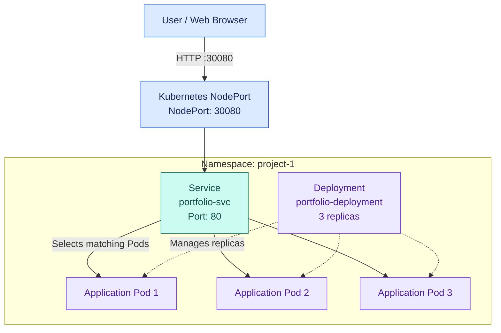

# Kubernetes Deployment of a Java Web Application

A hands-on Kubernetes project demonstrating application deployment, replica management, service networking, and application verification using Kubernetes manifests and `kubectl`.

## Architecture



**Request flow:** Browser → NodePort → Service → Application Pods.

The Deployment maintains the desired replica count. The Service provides a stable network endpoint and selects matching Pods. The cluster used for this exercise contained a control-plane node and a worker node.

## Project Configuration

| Component | Details |
|---|---|
| Namespace | `project-1` |
| Deployment | `portfolio-deployment` |
| Desired replicas | 3 |
| Service | `portfolio-svc` |
| Service type | NodePort |
| Service port | 80 |
| NodePort | 30080 |
| Configuration file | `manifest.yaml` |
| Kubernetes version shown | v1.30.14 |

## Technology Stack

- Kubernetes
- `kubectl`
- YAML manifests
- Java-based web application
- Kubernetes Deployments, Pods, Namespaces and Services

## Implementation

### 1. Create the namespace

```bash
kubectl create namespace project-1
```

### 2. Apply the Kubernetes manifest

```bash
kubectl apply -f manifest.yaml -n project-1
```

The command created the `portfolio-deployment` Deployment and `portfolio-svc` Service.

### 3. Verify the application Pods

```bash
kubectl get pods -n project-1
```

The output showed three Pods in the `Running` state, each with `1/1` containers ready and zero restarts at the time of verification.

### 4. Verify Kubernetes resources

```bash
kubectl get all -n project-1
```

The results confirmed:

- Three desired, current and ready replicas in the ReplicaSet.
- Three ready and available Deployment replicas.
- A NodePort Service exposing port `80` through node port `30080`.

### 5. Test browser access

The application was accessed using the reachable Kubernetes node IP and NodePort.

```text
http://<NODE-IP>:30080
```

Replace `<NODE-IP>` with the appropriate node IP address. Access depends on the cluster networking and firewall or security-group configuration.

## Results

- Successfully applied Kubernetes Deployment and Service manifests.
- Verified three running application Pods.
- Confirmed the Deployment had three ready and available replicas.
- Verified the NodePort Service configuration.
- Confirmed application access through a web browser.

## Key Learnings

- Deploying workloads using Kubernetes YAML manifests.
- Understanding Deployment and ReplicaSet responsibilities.
- Understanding how Services expose applications and select Pods.
- Working with namespaces and inspecting Kubernetes resources.
- Using `kubectl` to verify application health and deployment status.

## Repository Structure

```text
kubernetes-java-webapp/
├── manifest.yaml
└── README.md
```

| File | Description |
|---|---|
| `manifest.yaml` | Kubernetes Deployment and Service configuration |
| `README.md` | Project documentation and architecture |

## Scope and Notes

This project was completed as a practical exercise using a pre-written Kubernetes manifest. The work focused on applying the configuration, verifying the resources and replicas, and testing application access.

The architecture diagram is a logical representation of the request flow; it does not specify the individual node hosting each Pod.

---

**Project focus:** Kubernetes fundamentals · Workload management · Service networking · Deployment verification
