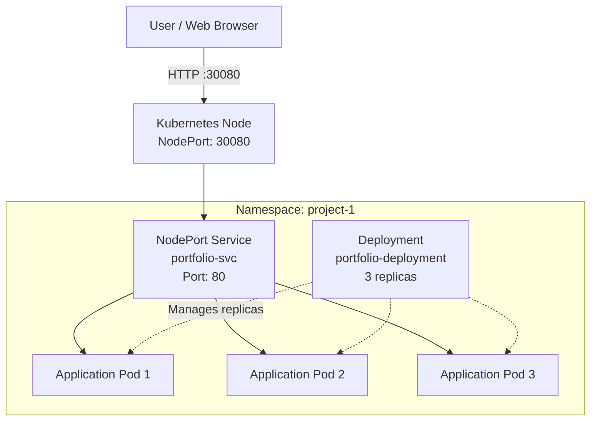
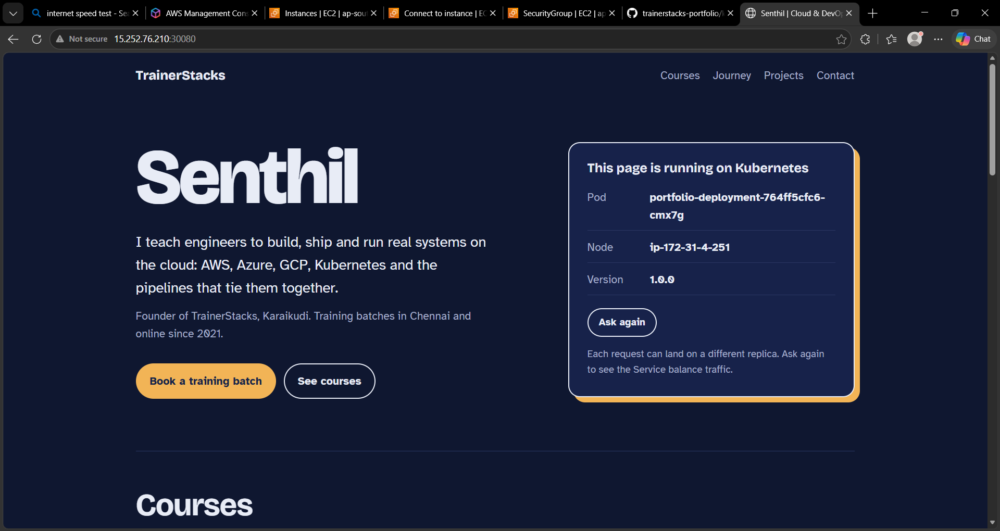
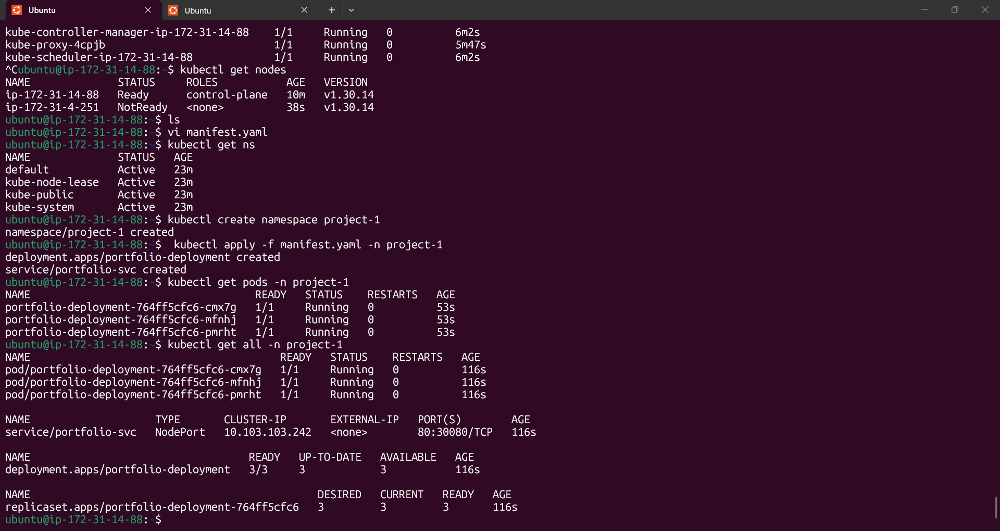

# Kubernetes Deployment of a Java Web Application

A hands-on Kubernetes project demonstrating application deployment, replica management, service networking, and application verification using Kubernetes YAML manifests and `kubectl`.

## Architecture



**Request flow:** User browser → Kubernetes NodePort → Service → Application Pods.

The Deployment manages the desired number of replicas. The Service provides a stable network endpoint and selects matching Pods.

The cluster information observed during the exercise included a control-plane node and a worker node. The exact placement of the application Pods is not specified.

## Project Configuration

| Component | Configuration |
|---|---|
| Namespace | `project-1` |
| Deployment | `portfolio-deployment` |
| Desired replicas | 3 |
| Service | `portfolio-svc` |
| Service type | NodePort |
| Service port | 80 |
| NodePort | 30080 |
| Kubernetes version observed | v1.30.14 |

## Technologies Used

- Kubernetes
- `kubectl`
- YAML manifests
- Java-based web application
- Kubernetes Deployments, ReplicaSets, Pods, Namespaces and Services

## Implementation

### 1. Create the namespace

```bash
kubectl create namespace project-1
```

### 2. Deploy the application

Apply the Kubernetes manifest to create the Deployment and Service.

```bash
kubectl apply -f manifest.yaml -n project-1
```

The command output confirmed the creation of `portfolio-deployment` and `portfolio-svc`.

### 3. Verify the Pods

```bash
kubectl get pods -n project-1
```

The observed output showed three Pods in the `Running` state, each with `1/1` containers ready and zero restarts at the time of verification.

### 4. Verify Kubernetes resources

```bash
kubectl get all -n project-1
```

The results confirmed:

- Three desired, current and ready replicas in the ReplicaSet.
- Three ready and available Deployment replicas.
- A NodePort Service mapping service port `80` to node port `30080`.

### 5. Access the application

The application was accessed through a web browser using the reachable Kubernetes node IP and NodePort.

```text
http://<NODE-IP>:30080
```

Replace `<NODE-IP>` with the appropriate reachable node IP. Access depends on cluster networking and the applicable firewall or security-group rules.

## Screenshots

### 1. Application Running in Browser

The browser screenshot demonstrates access to the application through the Kubernetes NodePort endpoint.



### 2. Kubernetes Terminal Output

Terminal evidence from the deployment exercise, showing Kubernetes commands and resource information.



## Results

- Applied the Kubernetes Deployment and Service manifests successfully.
- Verified three running application Pods.
- Confirmed three ready and available Deployment replicas.
- Verified the NodePort Service configuration.
- Accessed the application through a web browser.

## Key Learnings

- Deploying workloads using Kubernetes YAML manifests.
- Understanding Deployments and ReplicaSets.
- Understanding how Services expose applications and select Pods.
- Working with namespaces and inspecting Kubernetes resources.
- Using `kubectl` to verify application and deployment status.

## Repository Structure

```text
kubernetes-java-webapp/
├── manifest.yaml
├── README.md
└── screenshots/
    ├── applicationbrowser.png
    ├── terminal-verification.png
    └── terminal.png
```

## Project Scope

This project was completed as a practical exercise using a pre-written Kubernetes manifest. The work focused on applying the configuration, verifying Kubernetes resources and replicas, and testing application accessibility.

The documentation reflects the observed results and does not claim that the cluster or manifest was created independently from scratch.

---

**Project focus:** Kubernetes fundamentals · Deployment management · Service networking · Application verification
